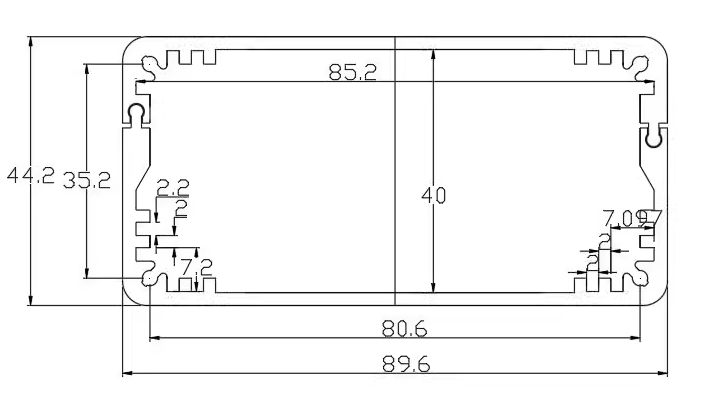
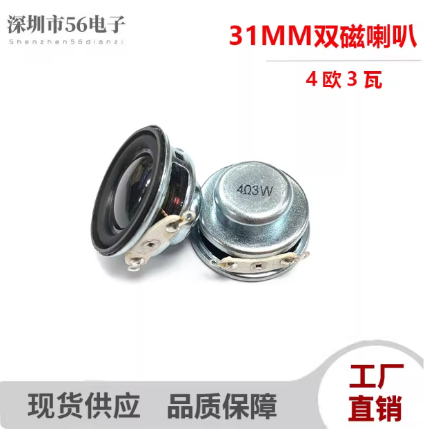

[VFO SQUARE(8051)](index.html) ■ [VFO BOX(STM32)](/vfo-box-stm32.html) ■ [Components](/components.html) ■  [FAQs](/faqs.html) ■ [About](/about.html)

# ■ 常用的器件

## ■ 电子元件：

* → 场管：2N7002, 用于5V与3.3V上SDA, SCL电平转换, SOT23-3
* → 电容：104，102电容, 滤波, 0805封装
* → 电阻: 4.7K, 2.2K, 100,1K, 10k, 3.3k 0805封装
* → 电感：100nh,或68nh,用于2.5V基准电压 0805封装
* → LED灯，SMD 0805封装
* → TL431, 用于ADC 2.5V参考电压
* → LDO: 3.3V我常用两种: (1)ASM1117-3.3 SOT23-封装 (2)662K, 5V： LM7805 TO-92封装
* → 25MHZ TCXO, 3225封装 [淘宝购买地址](https://item.taobao.com/item.htm?id=619683351756)
* → TL431, 用于ADC 2.5V参考电压
* → 单、双排针
* → SMA, IPEX 1.0V同轴连器
* → PH 2.0 DIP座

* 配合铝盒子尺寸： 90 * 44 * 100mm

* 点击这里购买：[淘宝地址](https://item.taobao.com/item.htm?id=611767722005&pisk=gjXtoXsZ0y4GLq0ZXZVnmQd8rUq3xWjwdNSSnEYiGwQdSeD0bdV2HZLduFAMCG2f-Nj7bFV4_ZQdSgZwSGTckZQe8OYGoZDvkgJ6g1YDSEpA0aE3r82lbGJ2Fz4uEgmVT5p6fET6coTBb3EHfOI0Txp2hz4otxOaeK7_eItzCXtB8nKj5I_bd2tXRnTX5ZTBO3to5K9flkLB4nMXcAMsdXtvRjt61AGIR3tDcE9XfkIB8nHXhK_XdkK2RE9Xhv7Qkei6oxCt8erENXrrHxBpXCLjneHvL9kk_UTvRxNcyhUyPGTKhxT80EV5vG4tUMvNAaKlSJMOyMjlQBWYyRdNdgBe6toxTMAyWpTNsPHeXNjAeB6_m0Y1Li6y9LFqreWVA_AyFVG62dL9NO_ncu96Gn96714tLhQGDTdCCockYs_FHdv7UVTctgBvDtz4paIhqORFHzeC4wBlebxjrUKm1kEKgjR6YxsV0IdaDdi9vUqTHjl2Tk-prkEKgjR6YHLuXPhqgBrF.&spm=tbpc.mytb_itemcollect.item.goods&upStreamPrice=1690)

* 配合喇叭： 31mm直径， 3瓦，4欧

* 喇叭这里购买：[淘宝地址](https://item.taobao.com/item.htm?id=702688632219&pisk=gGrooOqbkzu7SG-Wr9m5P6L37cQvF0iIKWKK9DhFujlbe2ldPW039SgU20e8ik28l8KdP03nxSlbeHQS2oDUgSiKa_iRK9VTOHF3dTMETWPn9zQAX8wSAD5TxGITF7j7DdVkY28VLAMyzt3zqybb6D5O6GLv341-YWIizv2XuAGqUv-r8tmqKAHrY2kz3tDEpQ8e4WyVnjMBYXlE8IRqBAHEY3oEuEkSUe-r82oV0jMEY3-UT-WmpjlEYDPU3xOXYfqUco5hFvLvolA7ZY0o_8lue8EVkq87Fj47yokuVPwyRH-UmY0u0p3TLR088Rg_2uSHc0egumkbvstrtrkgpmqhN3hI4Ag_WqAPFYUUhyl7j6xiaua0xmENOhFgwSrtvuWpo5unZrrrop-ED040tymwgtM88-aENlfHjbr7nP33P1Y__-eTVqZhsIlQyAiqhkCX4X4qLgkeuFuDTHMVpo8BR4kjnfEESXXGTWcDTtXD5agrhYCOntYBR4kjnfBcnFOIzxMR6&spm=tbpc.mytb_itemcollect.item.goods&upStreamPrice=350&skuId=4954049717567)

[VFO SQUARE(8051)](index.html) ■ [VFO BOX(STM32)](/vfo-box-stm32.html) ■ [Components](/components.html) ■  [FAQs](/faqs.html) ■ [About](/about.html)