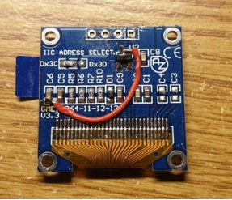

[VFO SQUARE(8051)](index.html) ■ [VFO BOX(STM32)](/vfo-box-stm32.html) ■ [Components](/components.html) ■  [FAQs](/faqs.html) ■ [About](/about.html)

# ■ 常见问题

## ■ 频率校准:

Si5351本身安装的25MHz TCXO(封装格式为3225), 根据Si5351芯片数据手册也可换成27MHz TCXO, 只需要3脚电压输入，4脚频率输出即可。安装各屏幕后，长按进入选项1-1，XTAL，即可进行校准，这里以25MHZ为例。

在进入25mhz校准模式下，CLK0, CLK1, CLK2均输出10MHz频率。

这里你可以使用频率计测量上面CLK0输入， 假如： 9.9999734MHZ, 即可你需要校正的25MHz应改为：24999933MHZ即可。

计算公式：

10.000 000 mhz 你需要的频率。
9.999 734 * 25 000 000 / 10 000 000 = 24 999 933
注意： TCXO需要运行一段时间，等温度稳定才行

## ■ 关于屏幕

* → 1、屏幕使用的是OLED 1306, 0.96或是1.3英寸均可。
* → 2、关于屏幕干扰短波，说是屏幕的电荷泵，常用两种方
* → (1)在VCC上串联色环电感330mH,再并联470uF电容到GND
* → (2)直接拆除C3, C4电容，再加一跳线如下图

实际此方法下屏亮度有所降低，但不影响使用。

[VFO SQUARE(8051)](index.html) ■ [VFO BOX(STM32)](/vfo-box-stm32.html) ■ [Components](/components.html) ■  [FAQs](/faqs.html) ■ [About](/about.html)