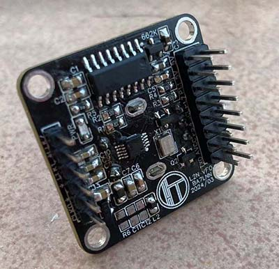
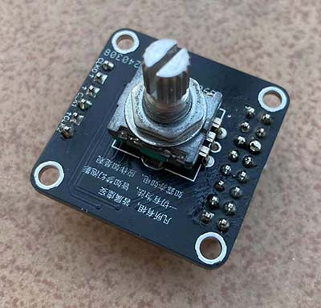
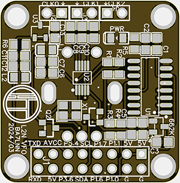
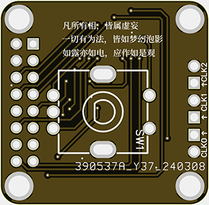
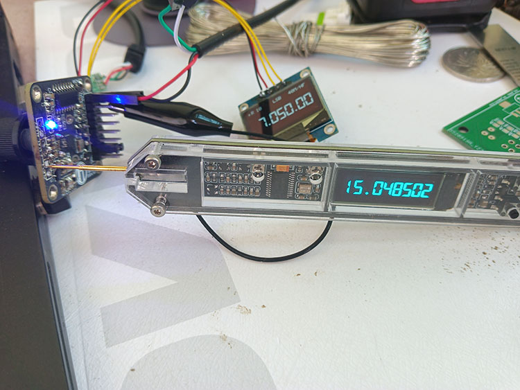
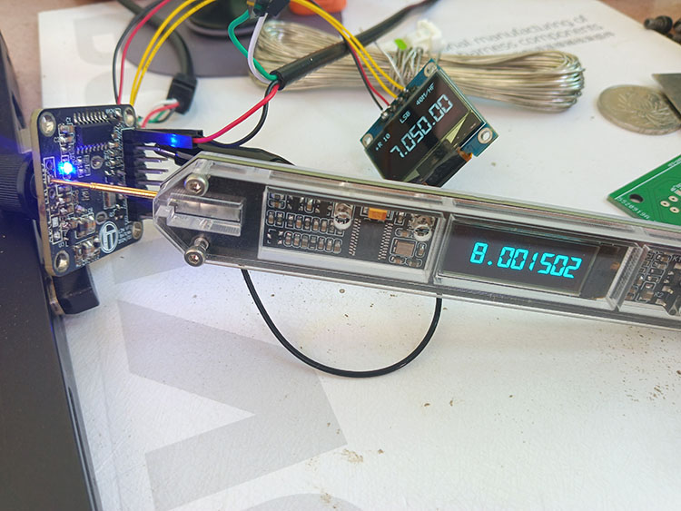

[VFO SQUARE(8051)](index.html) ■ [VFO BOX(STM32)](/vfo-box-stm32.html) ■ [Components](/components.html) ■  [FAQs](/faqs.html) ■ [About](/about.html)

# ■ VFO SQUARE

名称来源，方形SQUARE，似乎更有广场的意思，随它呢，唉，人生得意须尽欢，莫使金尊空对月。

## ■ 功能概要：

* → 支持USB/LSB/CW/FT8
* → 中频8MHz
* → 1206屏幕/OLED 0.96 Inch(12864 SSD1306)
* → 8051单片机
* → Si5351(SILICON LABS)/MS5351(国产)
* → 硬件开源资料，软件代码因写的丑不开源

## ■ 参数指标：

* → 频率范围： 30k-80Mhz
* → 只有一个中频8MHz
* → 步进：10,100,1K,10K,1M
* → 输出：-6~~8dbm
* → 供电压：5V, 板载LDO: 662K

## ■ 引脚功能概要

* → P3.6 ：PTT输出引脚，当手咪按下时，此时引脚低电位， 屏幕“R”字样变为“T”表 示由接收状态进入发射。
* → P5.4 ：波段选择，用于驱动继电器，选择7m或是14m
* → P1.6 ：SWR_F, 驻波输入正向功率
* → P1.7 ：SWR_R, 驻波输入反向功率
* → P1.0：输出引脚, 处在cw模式时，此时引脚低电位， 屏幕“CW”字样
* → P1.1：接收与发射切换引脚
* → RXD ：P3.0, UART RXD引脚
* → TXD ：P3.1, UART TXD引脚
* → SCL(P3.2) ： I2C时钟引脚，这里用于OLED屏
* → SDA(P3.3) ： I2C数据引脚，这里用于OLED屏
* → AVCC和5V ,使用跳线连接两个引脚时，启用ADC,经TL431后2.5V精准采样电压
* → 5V，GND(两路)， 一个输入供电，另一个用于OLED输出
* → P3.5 ：EC11编码器A向
* → P3.7 ：EC11编码器B向
* → P3.4 ：EC11编码器按键

注：I2C引脚也用于经PCF8574T后连接到1602屏，下载对应固件即可

## ■ 频率输出:

* → CLK0: 输出中频：8M或9M
* → CLK2: 输出中频：8M或9M 
* → CLK1: 输出VFO

注：每个CLKx 旁边均有GND引脚，需注意有箭头处为频率出脚, 如上图所注

## ■ 安装硬件:

* → 按照引脚功能，连接主板，通电前检查： 是否为5V供电

## ■ 资料

* →  <a href="/assets/2025/Schematic_VFO_SQUARE_2024-03-10.pdf">Schematic 原理图PDF</a>
* →  <a href="/assets/2025/VFO_SQUARE_1206_4SW.hex">(固件1 1206屏)L2N VFO MINI(HEX) 4按钮</a>
* →  <a href="/assets/2025/VFO_SQUARE_OLED_V1.4.hex">(固件2 OLED屏)L2N VFO MINI(HEX)</a>
* →  <a href="/assets/2025/vfo-square-manual.pdf">VFO SQUARE 使用手册</a>

* 主控MCU:  STC12C5A60S2-45I-LQFP44
*  → <a href="/assets/2025/stc12c5a60s2.pdf">STC12C5数据手册</a>
* 频率芯片: SI5351A-GTR
*  → <a href="/assets/2025/si5351_an619.pdf">Si5351 AN619开手册PDF</a>

<h2>■ 图片集</h2>

## ■ 写在后面:

→ 我踩过的坑： 
* 虽然都叫TL431但封装有不同，安装前要核对原理图和PCB。
* 玩Si5351,还是不要使用两脚封装的晶振（这里指49U或49S), 使用TCXO还是要轻松不少。

[VFO SQUARE(8051)](index.html) ■ [VFO BOX(STM32)](/vfo-box-stm32.html) ■ [Components](/components.html) ■  [FAQs](/faqs.html) ■ [About](/about.html)