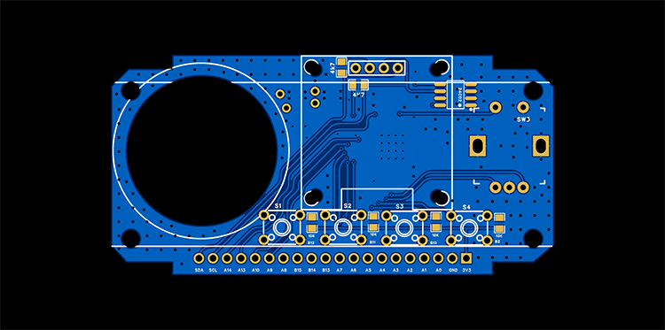
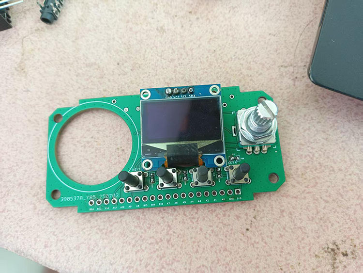
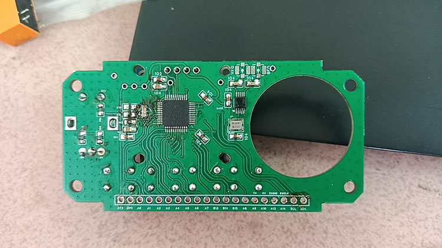

[VFO SQUARE(8051)](index.html) ■ [VFO BOX(STM32)](/vfo-box-stm32.html) ■ [Components](/components.html) ■  [FAQs](/faqs.html) ■ [About](/about.html)

# ■ VFO BOX(STM32)：

名称来源，配合有长方形盒子(BOX)。

## ■ 功能概要：

* → 支持USB/LSB/CW/FT8
* → 中频8MHz
* → 1206屏幕/OLED 0.96 Inch(12864 SSD1306)
* → ARM Contex-M3单片机 (STM32F103C8T6)
* → Si5351(SILICON LABS)/MS5351(国产)
* → 硬件开源资料，软件代码因写的丑不开源

## ■ 参数指标：

* → 频率范围： 30k-80Mhz
* → 只有一个中频8MHz
* → 步进：10,100,1K,10K,1M
* → 输出：-6~~8dbm
* → 供电压：5V, 板载LDO: 662K

## ■ 引脚功能：

* → SDA & SCL ：I2C引出引脚。
* → A14 ：
* → A13 ：
* → A10 ：RXD, UART RXD引脚。
* → A9 ：TXD, UART TXD引脚。
* → A8 ：
* → B15 ：当手咪按下时，此时引脚低电位， 屏幕“R”字样变为“T”表 示由接收状态进入发射。
* → B14 ：波段选择，用于驱动继电器，选择7m或是14m
* → B13：输出引脚, 处在cw模式时，此时引脚低电位， 屏幕“CW”字样
* → A7：接收与发射切换引脚
* → A6 ：
* → A3 ：
* → A2 ：电压检测引脚，整个的工作电压，一般检测13.8V。
* → A1 ：SWR_R, 驻波输入反向功率
* → A0 ：SWR_F, 驻波输入正向功率。

按键占用引脚：

* → B12 ：S1
* → B12 ：S2
* → B12 ：S3
* → B12 ：S4

EC11 编码器占用引脚：

* → B0 ：EC11编码器A向
* → P1 ：EC11编码器B向
* → C13 ：EC11编码器按键

## ■ 资料：

* 主控MCU:  STM32F103C8T6 LQFP48
*  → <a href="https://www.st.com/en/microcontrollers-microprocessors/stm32f103c8.html">ST官方页面</a>
* 频率芯片: SI5351A-GTR
*  → <a href="/assets/2025/si5351_an619.pdf">Si5351 AN619开手册PDF</a>

配合铝盒子及喇叭请查看常用器件列表

[VFO SQUARE(8051)](index.html) ■ [VFO BOX(STM32)](/vfo-box-stm32.html) ■ [Components](/components.html) ■  [FAQs](/faqs.html) ■ [About](/about.html)